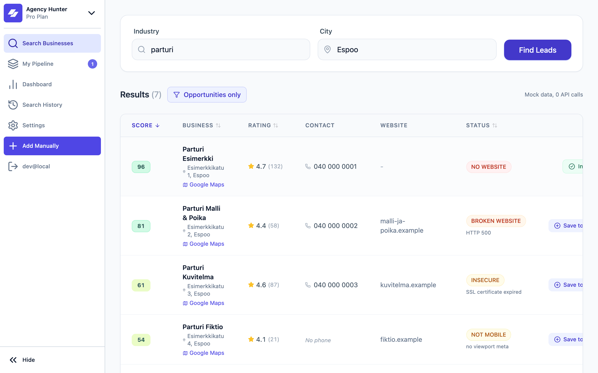
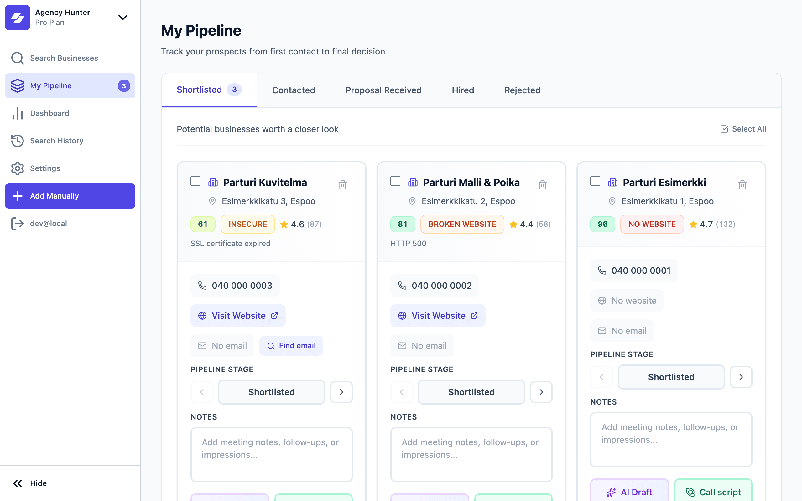
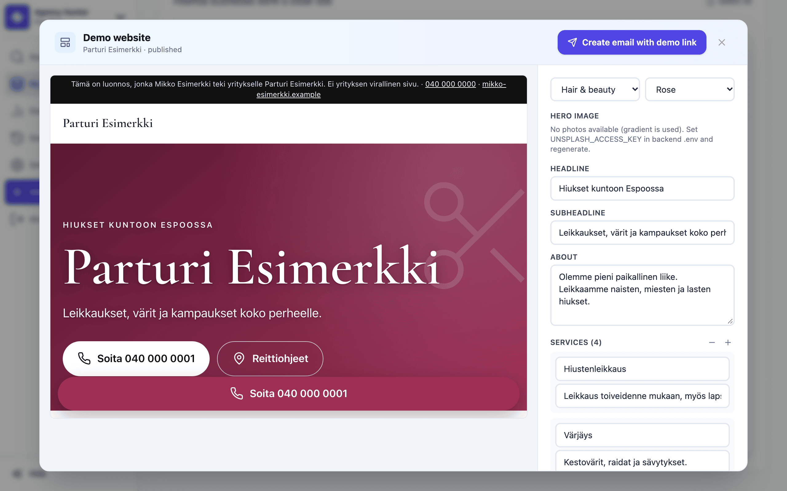
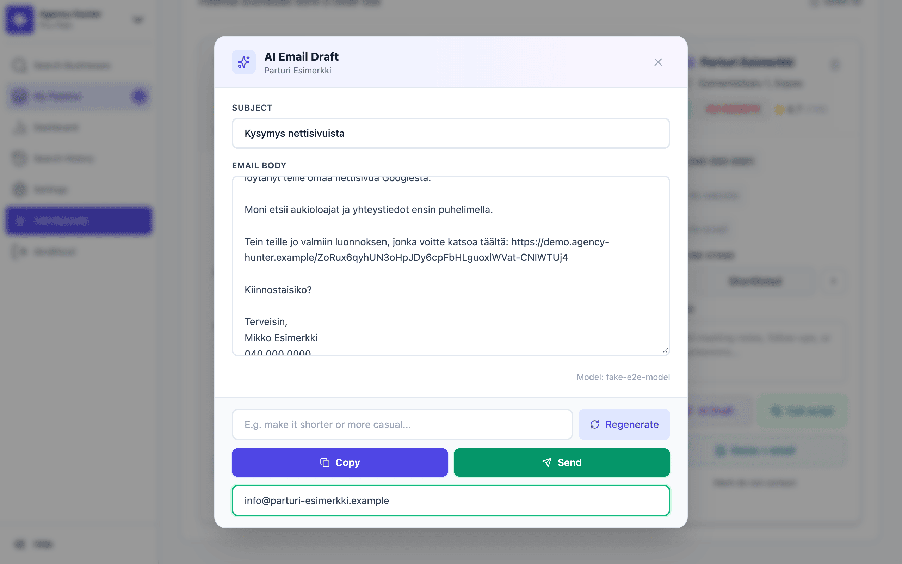
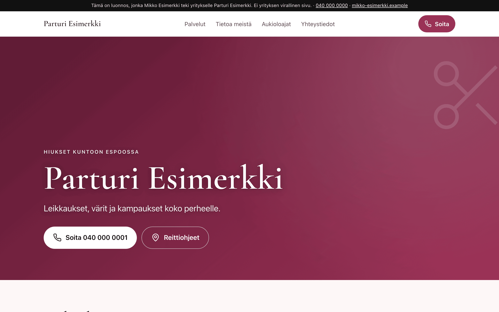
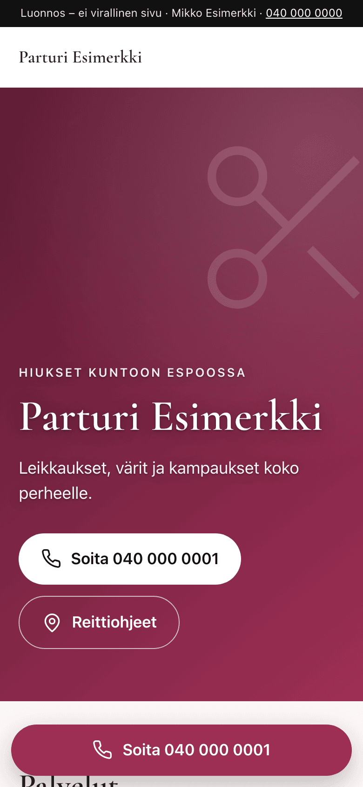
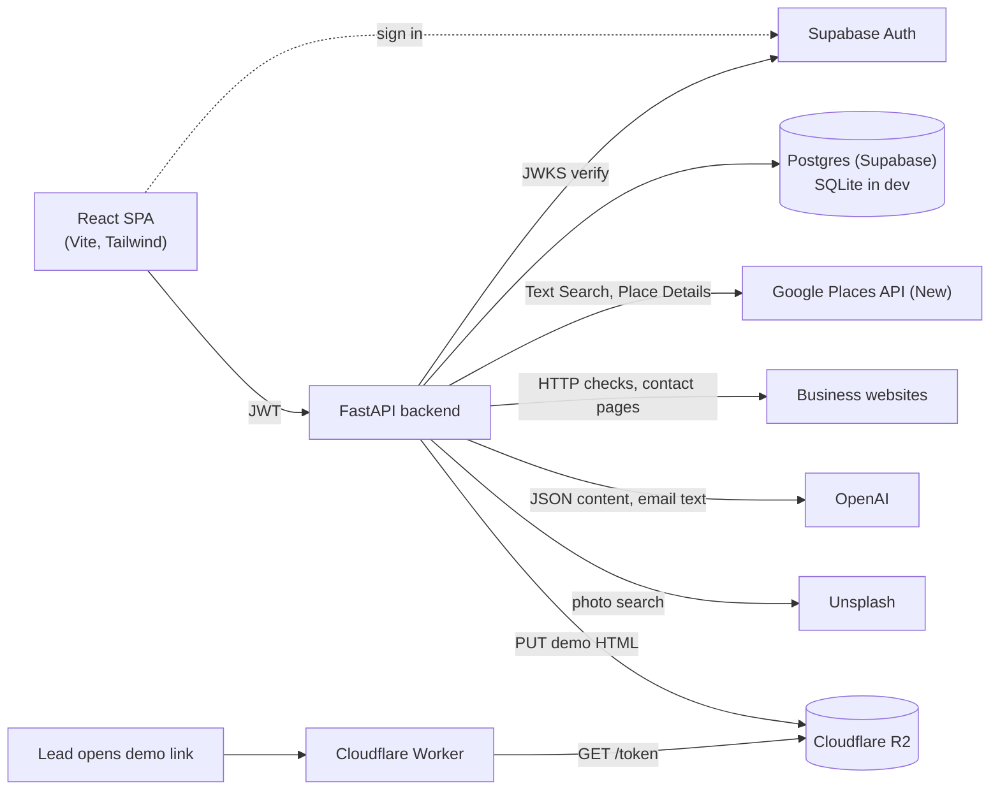

# Agency Hunter

Lead generator for web freelancers. It finds local businesses with a missing or broken website, scores them, and helps you contact them with a ready-made demo site.

[](https://github.com/Caroluspalin/Lead-Generator/actions/workflows/ci.yml)


<sub>Recorded in mock mode: fictional businesses, fake AI responses, no API keys. [MP4 version](docs/media/demo.mp4).</sub>

## Why

Many small local businesses (barbers, restaurants, plumbers) still have no website, or one that is broken, insecure or unusable on a phone. Finding them by hand from Google Maps is slow, and cold emails that say "I can build you a website" rarely get answers. Agency Hunter automates the research: it searches an area, checks every website, ranks the leads by opportunity, and produces a short personal email that links to a demo site already built for that business.

## Features

- **Search and scoring**: Google Places API (New) text search over a city with an adaptive grid. Every result gets a 0–100 lead score based on website status and popularity. Permanently closed places are dropped.
- **Website analysis with reasons**: each site is classified as `NO WEBSITE`, `BROKEN WEBSITE`, `INSECURE`, `NOT MOBILE`, `WEBSITE OK` or `UNKNOWN`, together with the reason (`HTTP 500`, `SSL certificate expired`, `social media only`, ...).
- **Pipeline**: Shortlisted → Contacted → Proposal Received → Hired / Rejected, with notes, bulk actions and a dashboard.
- **Email finding**: scans the homepage and up to three contact pages for addresses (mailto links, plain text, common obfuscations, Cloudflare email protection). It never guesses addresses.
- **AI messages and call scripts**: short Finnish cold emails and 30-second call scripts written from your sender profile and the actual observation about the lead's website.
- **Demo site generator**: one click builds a one-page site for the lead (three templates × three color schemes, real opening hours, optional Unsplash photos). You can edit the text before publishing.
- **Publishing**: demos are uploaded to Cloudflare R2 and served by a Worker at `https://<your-domain>/<token>`. "Publish & create email" puts the public link into the email draft.
- **Multi-tenancy**: Supabase Auth (JWT verified with JWKS). Every row is owned by a user and every query is filtered by `user_id`. Another user's resources return 404.

## Screenshots

| Search results with scores | Pipeline |
|---|---|
|  |  |
| **Demo editor (before publishing)** | **Email draft with the demo link** |
|  |  |

| Published demo, desktop | Published demo, mobile (390 px) |
|---|---|
|  |  |

## Architecture



**Request flow: from search to a sendable email**

1. `GET /search?business_type=parturi&city=Espoo` geocodes the city and runs Text Search over the viewport. The area is split 2×2 only where results hit the 60-result cap (max depth 2, hard limit of 15 calls per search).
2. Every website is checked in parallel threads (`asyncio.to_thread`). Results come back sorted by `lead_score`, together with the API call count and estimated cost.
3. `POST /leads` saves a lead to the pipeline. Email finding is optional and runs on demand.
4. `POST /leads/{id}/demo`: the model returns **JSON only** (headline, about, services), validated by Pydantic and by content rules. Jinja2 renders it into a fixed template with inline fonts, SVG icons, a draft banner and `noindex`.
5. `POST /leads/{id}/demo/publish` uploads the HTML to R2 with an expiry date. The Worker serves it with a strict CSP.
6. `POST /leads/{id}/email` with `require_demo_link` writes the email. Code adds the public link sentence, signature and opt-out line.

**Design principle: AI produces content, code decides format and safety rules.** The model never writes HTML and never decides what gets sent. Code validates its output and rejects numbers, prices, quotes, reviews, awards, company history and invented names in demo text. The model gets one retry with the errors listed, and then the request fails. Banned filler phrases are checked in code. Signature, opt-out line, demo link, price note and the "this is a draft" banner come from code, not from the prompt.

## Tech stack

| Layer | Technology |
|---|---|
| Frontend | React 19, TypeScript 5.9, Vite 7, Tailwind CSS 3, framer-motion, lucide-react, sonner |
| Backend | Python 3.13, FastAPI, SQLModel / SQLAlchemy 2, Alembic, Pydantic 2, Jinja2, BeautifulSoup |
| Database | PostgreSQL (Supabase, psycopg 3) in production, SQLite in development |
| Auth | Supabase Auth, JWT verification with PyJWT (JWKS for ES256/RS256, HS256 legacy) |
| External APIs | Google Places API (New), OpenAI, Unsplash |
| Demo hosting | Cloudflare R2 (boto3, S3 API) + Cloudflare Worker (TypeScript, wrangler) |
| Testing / CI | pytest + FastAPI TestClient, Node test runner, ESLint, GitHub Actions |

## Lead scoring

```
popularity = 0.7 · min(1, ln(1 + reviews) / ln(201))
           + 0.3 · clamp((rating − 3) / 2, 0, 1) · min(1, reviews / 10)

score = OPPORTUNITY[status] · (0.6 + 0.4 · popularity)
        − 15  if the place has no reviews
        − 40  if it is temporarily closed
```

| Website status | Opportunity |
|---|---|
| `NO WEBSITE` (incl. social media only) | 100 |
| `BROKEN WEBSITE` | 90 |
| `INSECURE`, `NOT MOBILE` | 65 |
| `UNKNOWN` (e.g. bot protection) | 50 |
| `WEBSITE OK` | 20 |

Scores are clamped to 0–100, and permanently closed places score 0 and are filtered out. Popularity can only scale the score down to 60 %, so the website problem always matters most. A popular business with no website lands near the top. See [backend/app/scoring.py](backend/app/scoring.py).

## Responsible use

This tool contacts real businesses, so it is built to be polite and conservative:

- **Opt-out in every message.** Code appends a line asking the recipient to reply "ei kiitos" (no thanks) to stop further contact.
- **Do not contact.** A lead marked *do not contact* blocks demo generation, publishing and emails. The backend returns `409`, not only the UI.
- **Demos are clearly drafts.** Every demo has a banner saying it is a draft made by you and not the business's official site. It is served with `noindex, nofollow` and expires after 30 days by default (extended when a lead is marked Hired).
- **No invented content.** Demos contain only facts from Google (name, address, phone, opening hours) plus generic service descriptions. Prices, reviews, history and awards are rejected by validation.
- **Third-party terms.** Google Places data is used as provided by the API (with the field mask kept minimal) and is not scraped from Maps. Unsplash photos are hotlinked with photographer attribution and download tracking, as the Unsplash API guidelines require.
- **Moderate pace.** Emails are drafted one at a time for manual review. Send them yourself, in small numbers, and check the marketing and privacy rules that apply to you (for example GDPR in the EU).

## Cost

List prices, before free monthly tiers (Google pricing 11/2026):

| Action | Estimated cost |
|---|---|
| Search, small city (e.g. Kauniainen, 3 calls) | ~$0.075 |
| Search, worst case (1 Geocoding + 14 Text Search) | ~$0.50 |
| Email or call script, `gpt-4o-mini` | ~$0.0003 (estimate) |
| Email or call script, `gpt-6.1-terra` (reasoning `low`) | ~$0.003 (estimate) |
| Demo site (AI + one Place Details call, Unsplash free) | ~$0.022 (measured) |
| Demo hosting (R2 + Worker) | within Cloudflare free tier at this scale |

The search view shows the call count and estimated cost of each search. Mock mode costs nothing.

## Getting started

**Requirements:** Python 3.13, Node.js 22+, Git. API keys are optional (see mock mode).

```bash
git clone https://github.com/Caroluspalin/Lead-Generator.git agency-hunter
cd agency-hunter
```

**Backend**

```bash
cd backend
python3.13 -m venv venv
source venv/bin/activate
pip install -r requirements.txt
cp .env.example .env          # then set AUTH_DISABLED=true for local use (see below)
alembic upgrade head          # creates agency_hunter.db (SQLite)
uvicorn app.main:app --reload # http://127.0.0.1:8000
```

**Frontend** (in a second terminal, from the repo root)

```bash
npm install
npm run dev                   # http://localhost:5173
```

### Mock mode (no API keys)

The app runs fully offline from Google:

- In `backend/.env` set `AUTH_DISABLED=true` and keep `USE_LIVE_GOOGLE=false`. Searches then return fictional businesses (`Parturi Esimerkki`, phone numbers `040 000 00xx`, `.example` domains) that cover every website status.
- Leave `VITE_SUPABASE_URL` / `VITE_SUPABASE_ANON_KEY` unset (no `.env.local`). The frontend then skips login and uses a local dev session.
- Search, scoring, the pipeline and the dashboard work without any keys. AI emails and demo content need `OPENAI_API_KEY`. Without `UNSPLASH_ACCESS_KEY` demos use a gradient hero. Publishing needs the R2 variables.

### Publishing demos (optional)

Create an R2 bucket and an R2 API token (Object Read & Write, that bucket only), then deploy the Worker:

```bash
cd worker
npm ci
npx wrangler login
npx wrangler deploy           # prints https://agency-hunter-demos.<account>.workers.dev
```

Set `R2_*` and `DEMO_PUBLIC_BASE_URL` (the Worker URL) in `backend/.env`. A custom domain can be added later in the Cloudflare dashboard without code changes. See [worker/wrangler.toml](worker/wrangler.toml).

## Environment variables

Backend (`backend/.env`, template in [backend/.env.example](backend/.env.example)):

| Variable | Required | Description |
|---|---|---|
| `DATABASE_URL` | yes | `sqlite:///agency_hunter.db` in dev, `postgresql://...` for Supabase / Postgres |
| `AUTH_DISABLED` | dev only | `true` skips JWT verification (local development only) |
| `SUPABASE_URL` | prod | Supabase project URL, used for JWKS token verification |
| `SUPABASE_JWT_SECRET` | optional | Only for legacy HS256 tokens |
| `SUPABASE_JWT_AUDIENCE` | optional | Defaults to `authenticated` |
| `ALLOWED_ORIGINS` | yes | Comma-separated CORS origins |
| `USE_LIVE_GOOGLE` | optional | `true` uses the real Places API, `false` returns mock data |
| `GOOGLE_API_KEY` | live search | Places API (New) + Geocoding key |
| `OPENAI_API_KEY` | AI features | Emails, call scripts and demo content |
| `EMAIL_MODEL` / `EMAIL_REASONING_EFFORT` | optional | Model for emails and call scripts (default `gpt-4o-mini`) |
| `SITE_MODEL` / `SITE_REASONING_EFFORT` | optional | Model for demo content (defaults to `EMAIL_MODEL`) |
| `UNSPLASH_ACCESS_KEY` | optional | Demo photos. Empty means a gradient hero |
| `UNSPLASH_APP_NAME` | optional | `utm_source` for Unsplash attribution links |
| `DEMO_PUBLIC_BASE_URL` | publishing | Public Worker URL, https, no trailing slash |
| `R2_ACCOUNT_ID`, `R2_ACCESS_KEY_ID`, `R2_SECRET_ACCESS_KEY`, `R2_BUCKET` | publishing | Cloudflare R2 credentials and bucket |
| `DEMO_TTL_DAYS` | optional | Demo lifetime in days (default 30) |
| `SMTP_HOST`, `SMTP_PORT`, `SMTP_USER`, `SMTP_PASSWORD`, `SMTP_FROM` | sending | SMTP server for the Send button |
| `SQL_ECHO` | optional | Log SQL statements |

Frontend (`.env.local`, template in [.env.example](.env.example)):

| Variable | Required | Description |
|---|---|---|
| `VITE_API_BASE` | optional | Backend URL (default `http://127.0.0.1:8000`) |
| `VITE_SUPABASE_URL`, `VITE_SUPABASE_ANON_KEY` | prod | Supabase project. Leave empty for dev mode without login |

## Testing

```bash
# Backend (from backend/, venv active)
pip install -r requirements-dev.txt
pytest

# Frontend (from the repo root)
npm run lint && npm run build

# Worker (from worker/)
npm test
```

Backend tests never touch the network. `conftest.py` blanks all API keys before the app is imported, uses an in-memory SQLite database and blocks real HTTP, OpenAI, SMTP and R2 calls. Tenant isolation is tested with two users. [GitHub Actions](.github/workflows/ci.yml) runs all three jobs on every push and pull request.

## Project structure

```
├── src/                    React frontend
│   ├── components/         LeadTable, PipelineBoard, DemoModal, EmailDraftModal, ...
│   ├── context/            Auth and pipeline state
│   └── lib/                API client, Supabase client
├── backend/
│   ├── app/
│   │   ├── main.py         API routes, search, website checks, AI prompts
│   │   ├── scoring.py      Lead score
│   │   ├── demo_site.py    Demo content validation and rendering
│   │   ├── demo_publish.py R2 upload and expiry
│   │   ├── text_quality.py Banned phrases, repetition checks
│   │   └── templates/demo/ Jinja2 templates
│   ├── migrations/         Alembic
│   └── tests/              pytest
├── worker/                 Cloudflare Worker serving published demos
└── docs/                   Architecture notes, roadmap, README media
```

## Roadmap

- Cloud deployment: backend on Render / Fly.io, frontend on Cloudflare Pages, monitoring with Sentry
- Supabase row-level security policies as defense in depth
- Lead detail side panel with notes history, drafts and a timeline
- Email open tracking
- Bulk email sending from the pipeline toolbar

The full list is in [docs/roadmap.md](docs/roadmap.md), and the current architecture is documented in [docs/save_state.md](docs/save_state.md) (in Finnish).

## Built with Claude Code

Most of the implementation was written in pair-programming sessions with [Claude Code](https://claude.com/claude-code). I set the requirements, constraints and review criteria for each phase and checked the results.
